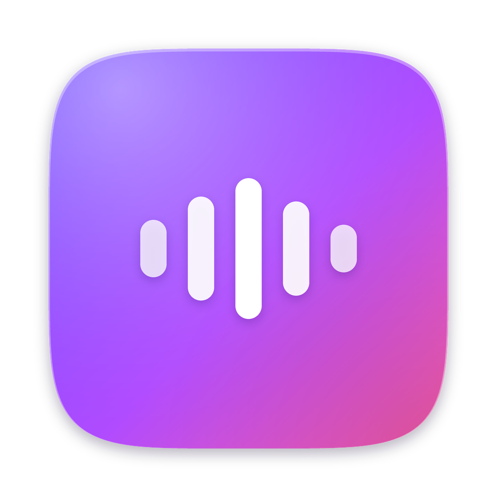
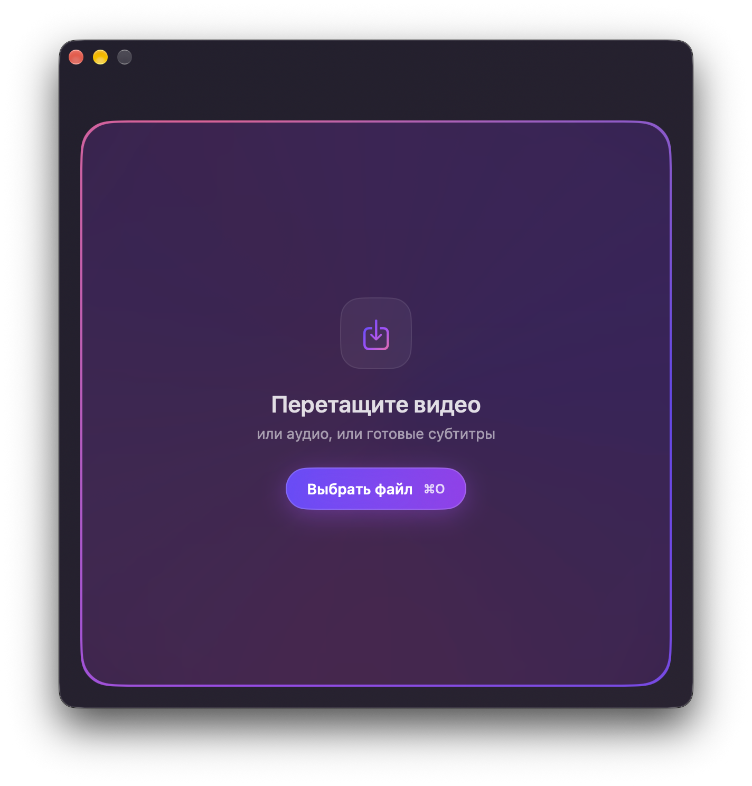
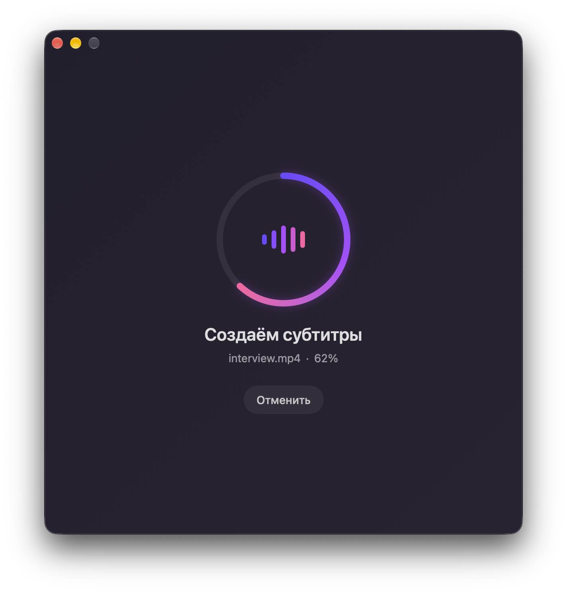
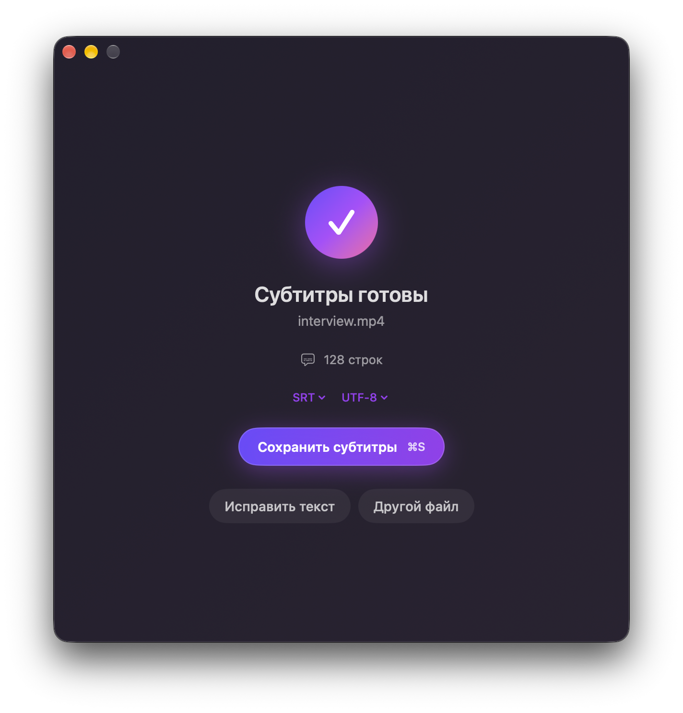
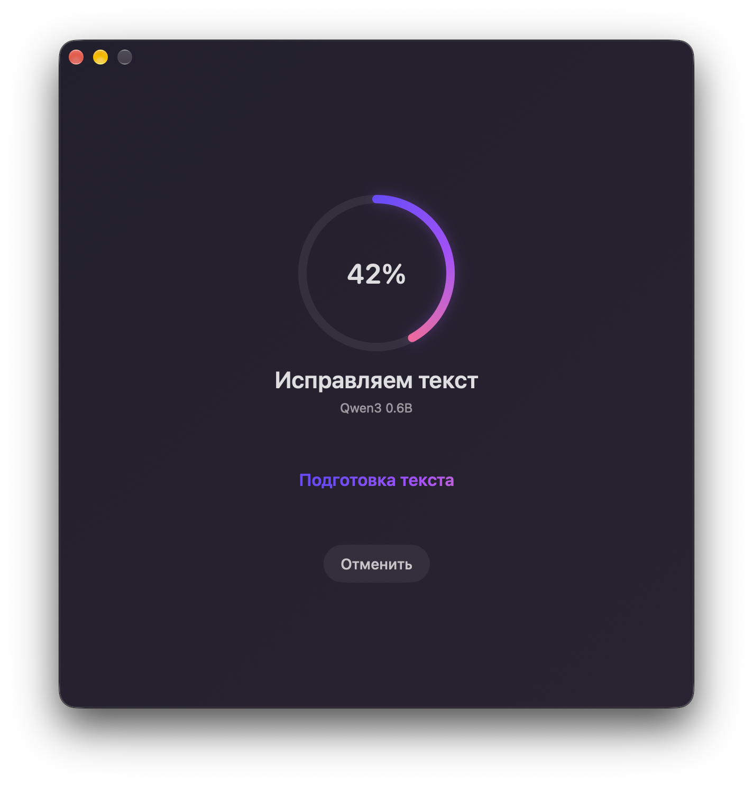

# WhisperDrop

<p align="center">
  
</p>

<p align="center">
  <b>Бесплатные локальные субтитры для macOS</b><br>
  Простое приложение для создания доступных субтитров, в том числе для слабослышащих — без загрузки медиа в облако
</p>

<p align="center">
  <a href="#русский">Русский</a> · <a href="#english">English</a>
</p>

<p align="center">
  <a href="https://github.com/fawkek/WhisperDrop/releases/download/v0.3.1/WhisperDrop-0.3.1-macOS.zip"><b>↓ Скачать тестовую сборку для macOS</b></a>
  &nbsp;·&nbsp;
  <a href="https://github.com/fawkek/WhisperDrop/releases">Все релизы</a>
</p>

---

<a id="русский"></a>

## Русский

WhisperDrop — бесплатное нативное приложение для macOS, которое распознаёт речь в аудио- и видеофайлах и создаёт субтитры на устройстве. Оно построено вокруг OpenAI Whisper Large v3 и особенно задумано как простой инструмент для подготовки доступных субтитров для слабослышащих

### Что умеет

- Распознаёт речь локально: исходные медиафайлы не отправляются на сервер
- Принимает видео, аудио или готовые субтитры: перетащите файл в окно приложения
- Предлагает выбрать нужную аудиодорожку, если в видео их несколько
- Автоматически определяет язык речи
- Создаёт `.srt`, `.vtt`, `.ass` и `.txt`
- Позволяет выбрать кодировку; по умолчанию — UTF-8 и SRT
- Нарезает текст на удобные для чтения реплики: не больше двух строк по 42 символа, до 7 секунд на экране, новая реплика после паузы и в конце предложения, переносы по смыслу, а не посреди фразы
- Выравнивает тайминги: реплики не перекрываются и не мигают, остаются на экране достаточно, чтобы успеть прочитать
- Убирает текст, который Whisper выдумывает в тишине и на музыке: титры вроде «Субтитры сделал…», зацикленные повторы, фразы без речи
- По желанию исправляет орфографию, пунктуацию, регистр и лишние пробелы в уже готовых субтитрах. Таймкоды и порядок реплик сохраняются
- Подстраивается под светлую и тёмную тему macOS и использует русский или английский интерфейс в зависимости от языка системы

### Как это работает

1. При первом запуске приложение предложит скачать модель распознавания **OpenAI Whisper Large v3**. Это наиболее точная доступная модель; она занимает примерно 1,6 ГБ и хранится на Mac. Если модель уже есть на диске или на другом Mac, выберите «У меня уже есть модель…»: приложение проверит файлы и скопирует их без загрузки
2. Перетащите видео или аудио в окно WhisperDrop
3. Если в файле несколько аудиодорожек, выберите язык, который нужно распознать
4. Дождитесь завершения распознавания. На экране будет круговой индикатор прогресса
5. Выберите формат и кодировку, если стандартные SRT и UTF-8 вам не подходят
6. Нажмите «Сохранить субтитры»

Для вычитки субтитров приложение отдельно скачивает выбранную MLX-модель вместе с её токенизатором (около 0,65–3,58 ГБ). Вычитка необязательна: базовое создание субтитров работает без неё

### Исправить готовые субтитры

Перетащите `.srt` или `.vtt` в первое окно WhisperDrop вместо видео. Приложение распознает тип файла и предложит исправить орфографию, пунктуацию, регистр и лишние пробелы локально на Mac. Таймкоды, порядок и количество реплик сохраняются

### Интерфейс / Interface

<table>
  <tr>
    <td align="center" width="50%"><br><sub>1. Выбор файла / Choose a file</sub></td>
    <td align="center" width="50%"><br><sub>2. Распознавание / Transcription</sub></td>
  </tr>
  <tr>
    <td align="center" width="50%"><br><sub>3. Субтитры готовы / Subtitles are ready</sub></td>
    <td align="center" width="50%"><br><sub>4. Исправление субтитров / Proofreading</sub></td>
  </tr>
</table>

### Установка и запуск

#### Скачать готовое приложение

Скачайте [WhisperDrop 0.3.1 для macOS](https://github.com/fawkek/WhisperDrop/releases/download/v0.3.1/WhisperDrop-0.3.1-macOS.zip), распакуйте ZIP и перенесите `WhisperDrop.app` в папку «Программы». Это тестовая сборка без Apple Developer ID и notarization, поэтому macOS может показать предупреждение при первом открытии. Модель распознавания не входит в архив: приложение предложит скачать её при первом запуске

#### Собрать из исходного кода

Приложение также можно собрать из исходного кода:

1. Для сборки нужен полный Xcode со Swift 6.3 или новее (проверено с Xcode 26.6); готовое приложение рассчитано на macOS 14 или новее. Выберите Xcode командой `sudo xcode-select -s /Applications/Xcode.app/Contents/Developer` и установите Metal Toolchain: `xcodebuild -downloadComponent MetalToolchain`
2. Склонируйте репозиторий или скачайте его ZIP-архив
3. В Терминале откройте папку проекта и выполните:

```bash
./script/build_and_run.sh
```

Скрипт соберёт и откроет `WhisperDrop.app`. Готовое приложение находится в `dist/WhisperDrop.app`. При первой сборке Xcode компилирует Metal-шейдеры MLX; следующие сборки используют кэш в `.build/mlx-metal`, пока не изменятся зависимости или Xcode. Библиотека `mlx.metallib` входит в приложение и ZIP, созданный с `--package`; пользователям готового приложения Xcode не нужен

### Приватность и хранение данных

WhisperDrop обрабатывает аудио, видео и текст субтитров только на вашем Mac. В интернет обращается лишь загрузчик моделей, если нужной модели ещё нет. Сами модели хранятся здесь:

```text
~/Library/Application Support/WhisperDrop/Models/
```

Их можно удалить, чтобы освободить место: при следующем использовании приложение снова предложит загрузку. Токенизатор распознавания входит в приложение; токенизатор вычитки скачивается вместе с выбранной моделью. Отдельно устанавливать их не нужно

### Как устроена вычитка

В текущем исходном коде вычитка выполняется локально через открытый [MLX Swift](https://github.com/ml-explore/mlx-swift) (MIT) и [MLX Swift LM](https://github.com/ml-explore/mlx-swift-lm) (MIT). Встроенный движок работает в процессе приложения и использует Metal на Apple Silicon. Модель загружается на время вычитки и затем освобождается из памяти; BaseRT больше не входит в сборку

На экране вычитки можно выбрать Qwen3.5 0.8B, 2B, 4B или Gemma 4 E2B в формате MLX 4-bit. Размер загрузки показан рядом с выбором модели. Файлы хранятся в `Models/Proofreading/<repository-name>/` внутри Application Support; загрузчик проверяет точный размер каждого файла и SHA-256 весов и токенизатора. По умолчанию выбрана **Qwen3.5 4B** для русского и английского; сохранённый выбор пользователя имеет приоритет


| Модель | Загрузка | Статус |
| --- | ---: | --- |
| Qwen3.5 0.8B | 0,65 ГБ | Компактная, экспериментальная |
| Qwen3.5 2B | 1,74 ГБ | Меньше размер, ниже точность |
| Qwen3.5 4B | 3,05 ГБ | По умолчанию; лучший результат в коротких тестах |
| Gemma 4 E2B | 3,58 ГБ | Экспериментальная |

В коротких тестах 4B снизила число ошибок с 13 до 8 на русском и с 13 до 3 на английском. Маленькие Qwen иногда объединяют соседние реплики, Gemma иногда меняет их содержимое; такие ответы отклоняются проверкой формата или защитным фильтром, и исходный текст сохраняется. Это ограниченный набор примеров, а не оценка точности на любых субтитрах. [Результаты и условия проверки](Docs/MLX-proofreading-benchmark.md)

Модели могут ошибаться, поэтому WhisperDrop принимает только безопасные правки: пунктуацию, регистр, пробелы и замену слова с опечаткой на настоящее слово по системной проверке орфографии. Правильно написанные слова не меняются, таймкоды и порядок реплик сохраняются

Хеши файлов моделей заданы в `Sources/WhisperDrop/Services/TextImprovementModelLocator.swift`. Поддержка MLX относится к разрабатываемой версии 0.4.0; опубликованная версия 0.3.1 использует прежний движок

### Требования

- macOS 14 Sonoma или новее
- Свободное место: около 1,7 ГБ для модели распознавания; ещё около 0,65–3,58 ГБ для выбранной модели вычитки
- Для локальной вычитки через MLX нужен Mac с Apple Silicon и Metal

### OpenAI Build Week: как использовались Codex и GPT-5.6

WhisperDrop развивался итеративно вместе с Codex и GPT-5.6. Они помогали находить причины сбоев при скачивании моделей и обработке субтитров, проверять Swift-код и чистую установку, улучшать нативный интерфейс macOS, стабилизировать парсинг и экспорт таймкодов, готовить локализацию, документацию и тестовые сборки. Все решения проверялись на реальном приложении и локальных моделях; итоговый код и релизы находятся в этом репозитории

[Посмотреть короткое демо для OpenAI Build Week](https://youtu.be/ttnF9ukFG0M)

### Статус проекта

Опубликована тестовая версия 0.3.1. Текущий исходный код готовится к версии 0.4.0 с MLX; этот выпуск ещё не опубликован. Подписанные и notarized сборки появятся после подключения Apple Developer ID

[Изменения](CHANGELOG.md) · [Сборка, диагностика и упаковка](Docs/DEVELOPMENT.md) · [Проверка моделей](Docs/MLX-proofreading-benchmark.md)

---

<a id="english"></a>

## English

WhisperDrop is a free native macOS app that turns audio and video into subtitle files on your own device. It is built around OpenAI Whisper Large v3 and designed to make accessible subtitle creation simple and private, including for people who are deaf or hard of hearing

### Features

- On-device transcription: your source media is never uploaded to a server
- Accepts video, audio, or an existing subtitle file — simply drop it onto the app window
- Lets you choose the audio track when a video contains more than one
- Automatically detects the spoken language
- Exports `.srt`, `.vtt`, `.ass`, and `.txt`
- Lets you choose the text encoding; UTF-8 and SRT are the defaults
- Cuts text into readable cues: at most two lines of 42 characters, up to 7 seconds on screen, a new cue after pauses and sentence ends, line breaks that keep phrases together
- Cleans up timing: no overlapping or flickering cues, and enough time on screen to read each one
- Removes text Whisper invents over silence and music: credits like "Subtitles by…", decoding loops, and phrases with no speech behind them
- Optionally proofreads spelling, punctuation, capitalization, and spacing while preserving cue timing and order
- Follows the macOS light/dark appearance and uses Russian or English according to the system language

### How it works

1. On first launch, WhisperDrop asks to download **OpenAI Whisper Large v3**. It is the most accurate available model, takes about 1.6 GB, and stays on your Mac. If you already have the model, choose "I already have the model…": the app verifies the files and copies them without downloading
2. Drop a video or audio file onto the WhisperDrop window
3. If the file contains multiple audio tracks, choose the language you want to transcribe
4. Wait for transcription to finish; progress is shown with a circular indicator
5. Choose an output format and encoding if the default SRT / UTF-8 combination is not right for your workflow
6. Click **Save Subtitles**

Subtitle proofreading downloads the selected local MLX model together with its tokenizer (about 0.65–3.58 GB). It is optional and is not needed for transcription

### Proofread existing subtitles

Drop an `.srt` or `.vtt` file onto the first WhisperDrop screen instead of a video. The app recognizes the file type and offers to correct spelling, punctuation, capitalization, and extra spacing locally on your Mac. Cue timing, order, and count are preserved

### Install and run

#### Download the app

Download [WhisperDrop 0.3.1 for macOS](https://github.com/fawkek/WhisperDrop/releases/download/v0.3.1/WhisperDrop-0.3.1-macOS.zip), unzip it, and move `WhisperDrop.app` to Applications. This is a test build without a Developer ID signature or notarization, so macOS may show a warning the first time it is opened. The transcription model is not included; the app offers to download it on first launch

#### Build from source

You can also build the project from source:

1. Building requires full Xcode with Swift 6.3 or later (tested with Xcode 26.6); the packaged app targets macOS 14 or later. Select Xcode with `sudo xcode-select -s /Applications/Xcode.app/Contents/Developer` and install the Metal Toolchain: `xcodebuild -downloadComponent MetalToolchain`
2. Clone the repository or download its ZIP archive
3. In Terminal, open the project folder and run:

```bash
./script/build_and_run.sh
```

The script builds and opens `WhisperDrop.app` at `dist/WhisperDrop.app`. On the first build, Xcode compiles MLX's Metal shaders; subsequent builds reuse `.build/mlx-metal` until dependencies or Xcode change. The app and the ZIP created with `--package` include `mlx.metallib`; users of the packaged app do not need Xcode

### Privacy and storage

WhisperDrop processes audio, video, and subtitle text locally on your Mac. It uses the network only to download a missing model. Models are stored here:

```text
~/Library/Application Support/WhisperDrop/Models/
```

You can remove them to free disk space; the app will offer to download them again when needed. The transcription tokenizer is bundled with the app; each proofreading tokenizer downloads with its model. Users do not need to install tokenizers separately

### How proofreading works

The current source runs proofreading locally through open-source [MLX Swift](https://github.com/ml-explore/mlx-swift) (MIT) and [MLX Swift LM](https://github.com/ml-explore/mlx-swift-lm) (MIT). The embedded engine runs in the app process and uses Metal on Apple Silicon. It loads the model for proofreading and releases it afterwards; BaseRT is no longer bundled

The proofreading screen offers Qwen3.5 0.8B, 2B, 4B and Gemma 4 E2B in MLX 4-bit format, with the download size shown next to the model choice. Files live under `Models/Proofreading/<repository-name>/` in Application Support. Downloads check every file’s exact size and the SHA-256 of weights and tokenizers. **Qwen3.5 4B** is the default for both Russian and English; a saved user selection takes precedence


| Model | Download | Status |
| --- | ---: | --- |
| Qwen3.5 0.8B | 0.65 GB | Smallest, experimental |
| Qwen3.5 2B | 1.74 GB | Smaller, lower accuracy |
| Qwen3.5 4B | 3.05 GB | Default; best result on the short fixtures |
| Gemma 4 E2B | 3.58 GB | Experimental |

On the short fixtures, 4B reduced errors from 13 to 8 in Russian and from 13 to 3 in English. Smaller Qwen models sometimes merge adjacent cues, and Gemma sometimes changes their content; the format checks or edit guard reject such responses and preserve the original text. These limited fixtures do not establish accuracy on arbitrary subtitles. [Results and test conditions](Docs/MLX-proofreading-benchmark.md)

Models can be wrong, so WhisperDrop keeps only safe edits: punctuation, capitalization, spacing, and replacing a misspelled word with a real word according to the system spell checker. Correctly spelled words are never changed, and cue timing and order are preserved

Model file hashes are defined in `Sources/WhisperDrop/Services/TextImprovementModelLocator.swift`. MLX support is part of the upcoming 0.4.0 source; the published 0.3.1 release uses the previous engine

### Requirements

- macOS 14 Sonoma or later
- Around 1.7 GB of free space for the transcription model; another 0.65–3.58 GB for the selected proofreading model
- Local MLX proofreading requires an Apple Silicon Mac with Metal

### OpenAI Build Week: how Codex and GPT-5.6 were used

WhisperDrop was developed iteratively with Codex and GPT-5.6. They helped trace failures in model downloads and subtitle processing, review Swift code and clean-device packaging, refine the native macOS interface, stabilize timestamp parsing and export, and prepare localization, documentation, tests, and release builds. Every change was validated against the real application and local models; the resulting code and releases are available in this repository

[Watch the short OpenAI Build Week demo](https://youtu.be/ttnF9ukFG0M)

### Project status

Test release 0.3.1 is published. The current source is being prepared for 0.4.0 with MLX; that release has not been published yet. Developer ID-signed and notarized builds will follow once an Apple Developer ID is connected

[Changelog](CHANGELOG.md) · [Build, troubleshooting and packaging](Docs/DEVELOPMENT.md) · [Model evaluation](Docs/MLX-proofreading-benchmark.md)

### Development and packaging

Run the test suite:

```bash
swift test
```

Create a distributable archive:

```bash
./script/build_and_run.sh --package
```

The resulting ZIP is suitable for local testing when ad-hoc signed. For Developer ID signing and notarization, see the [development guide](Docs/DEVELOPMENT.md). The current local package defaults to version 0.4.0, build 8; creating it does not publish a GitHub release

---

Made by [@fawkek_obj](https://x.com/fawkek_obj)

Released under the [MIT License](LICENSE)
